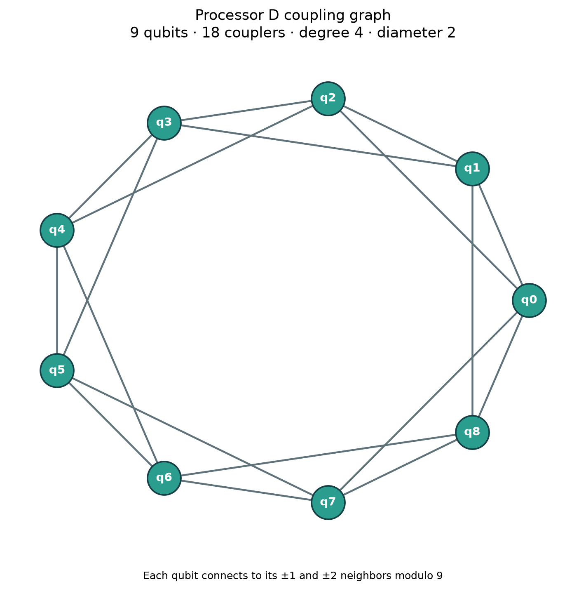

# Processor D Design

## Topology

Processor D is a 9-qubit, 18-edge circulant graph. Qubit `i` is connected to its
neighbors at offsets `+1`, `-1`, `+2`, and `-2` modulo 9. The graph is connected,
undirected, 4-regular, and has diameter 2. It therefore satisfies the nine-qubit
Bio-Sniff requirement while keeping every qubit at the allowed maximum degree.

The frozen configuration is [processor_D.json](../processors/processor_D.json).
Its gate set is exactly `rz`, `sx`, `x`, `cx`. Its listed noise rates are the
official values: one-qubit depolarizing `0.001`, CX depolarizing `0.005`, and
readout bit-flip `0.01`.

## Processor B Routing Probe

The locked L instance has 36 nonzero pair interactions in its p=1 cost layer;
the reference penalty couples every candidate pair. Before choosing D, a
representative bound p=1 circuit was passed to the official
`circuit_metrics()` helper on Processor B. The diagnostic angles were
`gamma=0.371`, `beta=0.613`; they were fixed solely to construct the routing
probe and were not optimized. The probe did not run a statevector expectation,
shots, noise simulation, or QAOA parameter optimization.

The probe used the helper's official optimization level 1, basis-gate set, and
transpiler seed 42. For L on B it measured 72 logical CX, 121 mapped CX, 17
routing-stage SWAPs, CX overhead 49, circuit depth 117, and two-qubit depth 79.
The B coupling graph has maximum pair distance 4 and mean pair distance
approximately 1.944.

## Rationale and Probe Comparison

The 4-regular distance-1/2 circulant design is intended to shorten routes for
the dense pairwise cost layer while respecting the degree limit. Running the
same diagnostic circuit and settings through `circuit_metrics()` on the frozen
D configuration measured 72 logical CX, 102 mapped CX, 10 routing-stage
SWAPs, CX overhead 30, circuit depth 87, and two-qubit depth 59. D's maximum
pair distance is 2 and its mean pair distance is 1.5.

These are routing/resource measurements for one fixed-angle diagnostic
circuit, not optimized QAOA benchmark results. They show lower routing metrics
for this probe but do not establish better placement quality, lower noisy
error, or an overall performance advantage. The uniform official noise rates
are recorded in the JSON; no noisy experiment was run for this design step.

## Trade-Offs

The additional couplers reduce graph distances for all-pairs interactions,
but require 18 couplers and give every qubit degree 4. On physical hardware,
that denser connectivity could increase control complexity or crosstalk. The
official synthetic noise model assigns uniform errors and cannot measure those
hardware-specific effects. The full ideal/noisy QAOA benchmark is still
required before drawing conclusions about solution quality or noisy behavior.